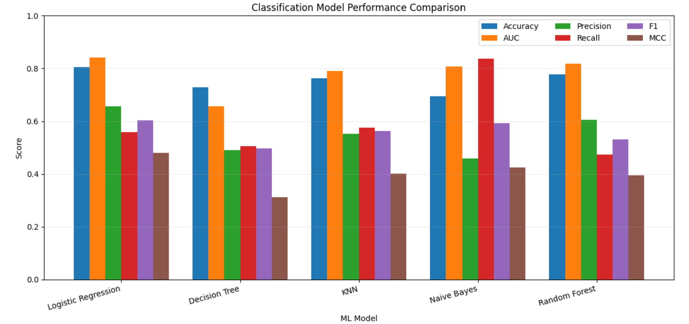

# Telco Customer Churn Classification

## a. Problem statement

Customer churn occurs when a customer stops using a company's service. The objective of this classification experiment is to predict whether a telecom customer will churn (`Yes`) or remain (`No`) using customer account, service and billing information. Five required classification algorithms are trained and evaluated on the same dataset.

## b. Dataset description

- **Dataset:** Telco Customer Churn
- **Source:** Kaggle public dataset (IBM Telco Customer Churn). Dataset source page: https://www.kaggle.com/datasets/blastchar/telco-customer-churn
- **Instances:** 7,043 rows
- **Original columns:** 21
- **Target variable:** `Churn` (`Yes` / `No`)
- **Predictor features used:** 19; `customerID` is excluded because it is an identifier, not a meaningful predictive input.
- **Feature types:** numeric (`SeniorCitizen`, `tenure`, `MonthlyCharges`, `TotalCharges`) and categorical (the remaining predictor columns).
- **Missing values:** 11 blank values in `TotalCharges` are converted to missing numeric values and imputed using the training-set median.
- **Duplicates:** 0 exact duplicate rows were found in the supplied data.
- **Class distribution:** No = 5,174 (73.46%); Yes = 1,869 (26.54%). The target is imbalanced, so stratification is used in the split.

The dataset was selected because it is a public binary classification dataset with more than the required 12 features and 1,000 instances, and it contains both numeric and categorical predictors and a meaningful churn target.

## c. GitHub Repository Link

**GitHub Repository:** [Add your own GitHub repository URL here after publishing this project.]

The repository should contain `requirements.txt`, this `README.md`, `test_data.csv`, the notebook, and the five Python model files under `model/`.

## d. Models used

### Preprocessing and experimental setup

1. Convert `TotalCharges` to numeric; blank entries become missing values.
2. Check and remove exact duplicate rows (none were found in this dataset).
3. Exclude `customerID` from model features and map `Churn`: No = 0, Yes = 1.
4. Split the data into 80% training and 20% testing with `stratify=y` and `random_state=42`.
5. Numeric features: median imputation followed by standard scaling.
6. Categorical features: most-frequent imputation followed by one-hot encoding.
7. Preprocessing is implemented inside each scikit-learn Pipeline, ensuring it is fitted only on training data.

### Model configurations

- Logistic Regression: `max_iter=2000`, `random_state=42`
- Decision Tree: `random_state=42`
- K-Nearest Neighbors: `n_neighbors=5`
- Naive Bayes: Gaussian Naive Bayes
- Random Forest: `n_estimators=300`, `random_state=42`

All five classifiers are instantiated by importing their `build_model()` functions from the separate `.py` files in the `model/` folder. The notebook applies the shared preprocessing pipeline, fits each classifier and calculates the metrics.

### Comparison table

All values are calculated on the same held-out test set. AUC uses predicted probability for the positive class (`Churn = Yes`).

| ML Model Name       |   Accuracy |    AUC |   Precision |   Recall |     F1 |    MCC |
|:--------------------|-----------:|-------:|------------:|---------:|-------:|-------:|
| Logistic Regression |     0.8055 | 0.8419 |      0.6572 |   0.5588 | 0.604  | 0.479  |
| Decision Tree       |     0.7289 | 0.6573 |      0.4896 |   0.5053 | 0.4974 | 0.3119 |
| KNN                 |     0.7637 | 0.7897 |      0.5527 |   0.5749 | 0.5636 | 0.4018 |
| Naive Bayes         |     0.6948 | 0.8074 |      0.4589 |   0.8369 | 0.5928 | 0.4245 |
| Random Forest       |     0.7786 | 0.8171 |      0.6062 |   0.4733 | 0.5315 | 0.3945 |

### Graph representation

### Observations on model performance
| ML Model Name | Observation about model performance |
|---|---|
| Logistic Regression | Best overall balance in this run: highest Accuracy (0.8055), AUC (0.8419), F1 (0.6040) and MCC (0.4790). |
| Decision Tree | Lowest AUC, F1 and MCC in this run, indicating weaker generalisation than the other tested classifiers. |
| KNN | Moderate performance across the metrics; its F1 and AUC are below Logistic Regression in this experiment. |
| Naive Bayes | Highest Recall (0.8369), so it identifies the largest share of churners, but its precision is comparatively low. |
| Random Forest | The ensemble provides competitive AUC, but its recall and F1 are lower than Logistic Regression in this experiment. |

### Overall Winner

**Logistic Regression** is the overall winner in this experiment based on the highest F1 score. F1 is used as the selection criterion because the churn classes are imbalanced and F1 balances precision and recall. Logistic Regression also leads on Accuracy, AUC and MCC in this run. Naive Bayes has the highest Recall, which may be useful when identifying as many potential churners as possible is the priority.

## Execution instructions

1. Download or clone this repository.
2. Install dependencies from requirements.txt.
3. Open `2026CT05071_ML_Assignment2.ipynb` in Jupyter.
4. Run all notebook cells from top to bottom. Keep `test_data.csv` and the `model/` in the path as mentioned in the code.
5. The notebook prints the six metrics for each classifier and generates the comparison graph.
## Reproducibility note

The train-test split uses `random_state=42` and stratification. Metric values may vary if the dataset file or software versions are changed. The values shown above were produced from the included `test_data.csv` using the configurations documented here.
